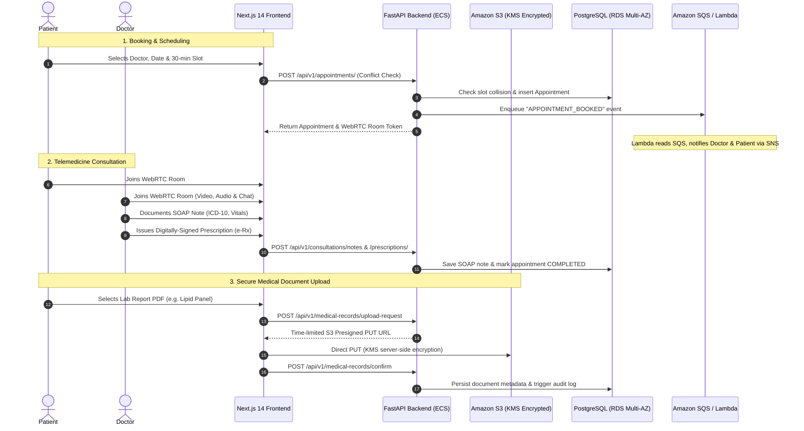

# CareFlow – Cloud-Native Clinic & Telemedicine Platform

[](https://github.com/careflow/careflow-platform)
[](https://github.com/careflow/careflow-platform)
[](https://opensource.org/licenses/MIT)
[](https://fastapi.tiangolo.com)
[](https://nextjs.org)
[](https://aws.amazon.com)
[](https://aws.amazon.com/compliance/hipaa-compliance/)

> **CareFlow** is an enterprise-grade, cloud-native clinic management and telemedicine SaaS platform engineered with **React/Next.js 14**, **FastAPI**, **PostgreSQL**, **Docker**, and **17 core AWS cloud services**. Built from the ground up to demonstrate production software engineering standards, distributed cloud architecture, HIPAA-conscious healthcare security, and automated CI/CD pipelines.

---

## 📑 Table of Contents
1. [Platform Architecture & Cloud Infrastructure](#-platform-architecture--cloud-infrastructure)
2. [Genuine AWS Cloud Services Breakdown](#-genuine-aws-cloud-services-breakdown)
3. [Core Clinical & Telemedicine Workflows](#-core-clinical--telemedicine-workflows)
4. [Security, Encryption & HIPAA Model](#-security-encryption--hipaa-model)
5. [Interactive Demo Credentials](#-interactive-demo-credentials)
6. [Local Quickstart (Docker & Native)](#-local-quickstart-docker--native)
7. [Terraform Deployment Guide](#-terraform-deployment-guide)
8. [API Documentation (FastAPI OpenAPI)](#-api-documentation-fastapi-openapi)
9. [CI/CD & Security Vulnerability Scanning](#-cicd--security-vulnerability-scanning)
10. [Repository Structure](#-repository-structure)

---

## 🏗 Platform Architecture & Cloud Infrastructure

CareFlow is architected with a decoupled, asynchronous, 3-tier microservices design. Protected Health Information (PHI) never passes unencrypted across trust boundaries.

### High-Level Architecture Diagram

```
                        [ Internet Traffic ]
                                 │
                                 ▼
                     ┌───────────────────────┐
                     │   AWS WAFv2 Web ACL   │ (SQLi, Rate Limiting, Bad Inputs)
                     └───────────┬───────────┘
                                 │
                                 ▼
                 ┌───────────────────────────────┐
                 │     Amazon CloudFront CDN     │
                 └───────┬───────────────┬───────┘
       (Static UI Assets)│               │(/api/* & /docs)
                         ▼               ▼
             ┌──────────────────┐   ┌───────────────────────────┐
             │ Frontend S3 (OAC)│   │  Application Load Balancer│
             └──────────────────┘   │     (Public Subnets)      │
                                    └─────────────┬─────────────┘
                                                  │
                                                  ▼
                                    ┌───────────────────────────┐
                                    │    ECS Fargate Service    │
                                    │   (Private App Subnets)   │
                                    └──────┬──────┬──────┬──────┘
                                           │      │      │
            ┌──────────────────────────────┘      │      └──────────────────────────┐
            ▼                                     ▼                                 ▼
┌───────────────────────┐             ┌───────────────────────┐         ┌───────────────────────┐
│  Amazon RDS Postgres  │             │   Encrypted S3 Bucket │         │     Amazon Cognito    │
│  (Multi-AZ Private DB)│             │ (KMS Presigned URLs)  │         │   (User Pool & RBAC)  │
└───────────────────────┘             └───────────┬───────────┘         └───────────────────────┘
                                                  │ (s3:ObjectCreated)
                                                  ▼
                                      ┌───────────────────────┐
                                      │ Lambda Document Scan  │
                                      │  (SHA-256 & Malware)  │
                                      └───────────────────────┘

                 [ Asynchronous Decoupled Event Flow ]
         FastAPI Event ──► Amazon SQS Queue (DLQ Redrive) ──► Lambda Notifier ──► Amazon SNS Alerts
```

### End-to-End Consultation & EHR Sequence Diagram



---

## ⚡ Genuine AWS Cloud Services Breakdown

Each AWS service is utilized for an explicit, production-grade architectural purpose:

| AWS Service | Production Purpose in CareFlow |
|:---|:---|
| **VPC** | 3-tier isolated network spanning 2 Availability Zones: Public Subnets (ALB & NAT Gateways), Private App Subnets (ECS Fargate containers), and Private Database Subnets (RDS PostgreSQL). |
| **IAM** | Principle of least privilege: distinct `ECS Task Execution Role` (ECR pull, CloudWatch logs, Secrets Manager), `ECS Task Role` (S3/SQS/SNS operations), and `Lambda Execution Roles`. |
| **Amazon Cognito** | Cloud identity provider with User Pool, App Client, and Role-Based User Groups (`Patients`, `Doctors`, `Admins`). Synchronized with backend JWT verification. |
| **ECS Fargate** | Serverless container orchestration running the FastAPI application. Automatically scales out based on CPU/memory utilization without host VM management. |
| **Amazon ECR** | Container image repository with image tagging, immutable tags, and automatic vulnerability scanning upon push. |
| **Application Load Balancer (ALB)** | Distributes incoming HTTPS traffic across ECS Fargate tasks with automated target group health checks (`/health` endpoint). |
| **AWS WAFv2** | Web Application Firewall attached to ALB & CloudFront. Protects against SQL Injection (`AWSManagedRulesSQLiRuleSet`), Common Exploits (`AWSManagedRulesCommonRuleSet`), and enforces Rate Limiting (1,000 req / 5 min / IP). |
| **Amazon RDS PostgreSQL** | Multi-AZ relational database for high availability and automatic failover. Master storage encrypted with AWS KMS CMK. |
| **Amazon S3** | Medical records bucket with strict S3 Block Public Access, server-side KMS encryption, versioning, and lifecycle policy (transitioning to Glacier after 365 days for HIPAA archive compliance). |
| **AWS KMS** | Customer-Managed Key (CMK) with automated annual rotation, securing RDS, S3 objects, Secrets Manager, and CloudWatch logs. |
| **AWS Secrets Manager** | Secure storage and automatic injection of database credentials and JWT signing keys without plaintext exposure in code. |
| **AWS Lambda** | Asynchronous serverless event workers: (1) `appointment_notifier` processing SQS reminder batches, and (2) `document_scanner` inspecting uploaded S3 medical files for SHA-256 integrity and malware. |
| **Amazon SQS** | Decouples synchronous API responses from asynchronous notification delivery. Includes a Dead-Letter Queue (DLQ) with redrive policies for failed messages. |
| **Amazon SNS** | Publishes urgent clinical alerts and sends multi-channel SMS/Email notifications to patients and medical staff. |
| **Amazon CloudWatch** | Aggregates application container logs (`awslogs`), provides an operational monitoring dashboard, and triggers automated alarms on 5xx errors or CPU spikes. |
| **AWS CloudTrail** | Multi-region audit trail recording all AWS management events, S3 data actions, and KMS cryptographic calls to an encrypted audit bucket. |
| **Amazon CloudFront** | Global Content Delivery Network with Origin Access Control (OAC), serving static Next.js assets with low latency and routing `/api/*` to the ALB. |

---

## 🩺 Core Clinical & Telemedicine Workflows

### 1. Multi-Role RBAC & Profile Management
- **Patients**: Manage medical profile, emergency contacts, drug allergies, chronic conditions, and insurance policies.
- **Doctors**: Manage clinical profile, hospital affiliations, licensing credentials, consultation fees, and recurring weekly schedule availability templates.
- **Clinic Administrators**: Comprehensive overview of clinic analytics, user activation/deactivation, and HIPAA regulatory audit logs.

### 2. Dynamic Availability & Double-Booking Prevention
- Real-time calculation of available 30-minute booking slots (`/api/v1/doctors/{id}/available-slots?target_date=YYYY-MM-DD`).
- Strict transactional conflict prevention preventing duplicate bookings for the same doctor and time.

### 3. WebRTC Telemedicine Consultation Room
- Integrated video and audio room interface with camera/microphone toggle controls and screen preview.
- In-call end-to-end encrypted chat for confidential in-consultation communication.
- Live physician SOAP notes drawer allowing doctors to document clinical findings during the call.

### 4. SOAP Clinical Documentation & ICD-10 Coding
- Standardized medical documentation framework:
  - **Subjective [S]**: Patient symptoms, complaint duration, history of present illness.
  - **Objective [O]**: Physical examination, lung/heart sounds, laboratory findings.
  - **Assessment [A]**: Clinical diagnosis and differential diagnoses.
  - **Plan [P]**: Pharmacological interventions, patient education, follow-up dates.
- Integrated **ICD-10** diagnosis codes (e.g., `I10` for Hypertension, `R00.0` for Tachycardia).
- Structured Vital Signs tracking: Blood Pressure (mmHg), Heart Rate (bpm), Body Temperature (°F), Oxygen Saturation ($SpO_2$ %).

### 5. Digitally Signed Electronic Prescriptions (e-Rx)
- Electronic prescription generator with medication name, dosage form, administration frequency, duration, and patient instructions.
- Generates a tamper-evident, verifiable prescription code (e.g., `RX-2026-CARDIO-881`).
- Digital signing timestamp by the licensed physician.

### 6. HIPAA Audit Trail
- Regulatory immutable audit log recording every access to Protected Health Information (PHI):
  - `actor_id`, `actor_email`, `actor_role`
  - `action` (`VIEW_CLINICAL_NOTE`, `DOWNLOAD_MEDICAL_RECORD`, `BOOK_APPOINTMENT`, `ISSUE_PRESCRIPTION`)
  - `resource_type`, `resource_id`
  - `ip_address`, `user_agent`, `timestamp`, `diff/metadata`

---

## 🔒 Security, Encryption & HIPAA Model

CareFlow implements defense-in-depth across the entire application lifecycle:

1. **Zero-Knowledge S3 Presigned Uploads**: Protected Health Information (PHI) documents never pass unencrypted through API servers. Clients request short-lived presigned URLs and upload directly to Amazon S3.
2. **KMS Encryption at Rest**: Amazon RDS storage, S3 medical record buckets, Secrets Manager secrets, and CloudWatch log groups are encrypted using a Customer Managed Key (CMK) with automated rotation.
3. **TLS 1.2+ in Transit**: Enforced across CloudFront, ALB HTTPS listeners, and S3 bucket policies (`aws:SecureTransport = false` is denied).
4. **Private Subnet Isolation**: Backend ECS containers and PostgreSQL databases reside strictly in private subnets with no public IPv4 addresses, accessible only via ALB reverse proxy and NAT gateways.
5. **Least-Privilege RBAC**: FastAPI endpoints enforce dependency-injected role checks (`require_role([UserRole.DOCTOR])`) and ownership verification for every record.

---

## 🚀 Interactive Demo Credentials

CareFlow features an **Instant 1-Click Demo Switcher** in the top navigation bar, enabling recruiters and interviewers to seamlessly evaluate the system across all three roles:

| Role | Email | Password | Access Capabilities |
|:---|:---|:---|:---|
| **Administrator** | `admin@careflow.health` | `CareFlowAdmin123!` | Clinic KPIs, User Management, HIPAA Audit Log Viewer |
| **Doctor** | `dr.smith@careflow.health` | `DoctorPass123!` | Patient Queue, WebRTC Video, SOAP Notes, e-Prescriptions |
| **Patient** | `patient.john@example.com` | `PatientPass123!` | Browse Doctors, Book Appointments, View e-Rx, Upload Records |

---

## 💻 Local Quickstart (Docker & Native)

### Option A: Complete Docker Compose (Recommended)

Start the entire platform (PostgreSQL, FastAPI backend, Next.js frontend, and seeded demo data) with a single command:

```bash
# Clone the repository
git clone https://github.com/careflow/careflow-platform.git
cd careflow-platform

# Start full-stack environment
docker compose up --build -d

# Verify running containers
docker compose ps
```

- **Frontend Application**: [http://localhost:3000](http://localhost:3000)
- **FastAPI OpenAPI Swagger UI**: [http://localhost:8000/docs](http://localhost:8000/docs)
- **FastAPI ReDoc**: [http://localhost:8000/redoc](http://localhost:8000/redoc)
- **Health Check**: [http://localhost:8000/health](http://localhost:8000/health)

---

### Option B: Native Local Development

#### 1. Backend Setup
```bash
cd backend

# Create and activate Python virtual environment
python3 -m venv .venv
source .venv/bin/activate

# Install dependencies
pip install -r requirements.txt

# Run migrations and seed database
python -m app.seed

# Run automated tests
pytest -v

# Start FastAPI dev server
uvicorn app.main:app --host 0.0.0.0 --port 8000 --reload
```

#### 2. Frontend Setup
```bash
cd frontend

# Install Node.js dependencies
npm install

# Build application
npm run build

# Start Next.js development server
npm run dev
```

Visit [http://localhost:3000](http://localhost:3000) and click **"1-Click Demo Login"** to begin testing immediately.

---

## ☁️ Terraform Deployment Guide

The `terraform/` directory contains modular Infrastructure as Code (IaC) for AWS deployment:

```bash
cd terraform

# 1. Copy example variables file
cp terraform.tfvars.example terraform.tfvars

# 2. Configure AWS credentials
export AWS_REGION="us-east-1"
export AWS_ACCESS_KEY_ID="AKIA..."
export AWS_SECRET_ACCESS_KEY="..."

# 3. Initialize Terraform providers and modules
terraform init

# 4. Validate syntax and plan infrastructure
terraform plan

# 5. Apply infrastructure to AWS
terraform apply -auto-approve
```

---

## 📖 API Documentation (FastAPI OpenAPI)

CareFlow exposes a clean REST API adhering to RFC 7807 problem details:

| Method | Endpoint | Description | Role Required |
|:---|:---|:---|:---|
| `POST` | `/api/v1/auth/register` | Register new patient or doctor account | Public |
| `POST` | `/api/v1/auth/login` | Authenticate user & return JWT token | Public |
| `GET` | `/api/v1/auth/me` | Retrieve profile of authenticated user | Authenticated |
| `GET` | `/api/v1/doctors/` | Search & paginate verified physicians | Public |
| `GET` | `/api/v1/doctors/{id}/available-slots` | Calculate dynamic slot availability | Public |
| `POST` | `/api/v1/appointments/` | Book appointment & generate room ID | Patient / Staff |
| `GET` | `/api/v1/appointments/` | List appointments (role-scoped) | Authenticated |
| `POST` | `/api/v1/appointments/{id}/cancel` | Cancel consultation & notify via SQS | Authenticated |
| `POST` | `/api/v1/consultations/notes` | Record SOAP clinical note & vitals | Doctor |
| `GET` | `/api/v1/consultations/notes/{id}` | Retrieve clinical notes (HIPAA logged) | Doctor / Patient |
| `POST` | `/api/v1/prescriptions/` | Issue digitally-signed e-prescription | Doctor |
| `GET` | `/api/v1/prescriptions/my-prescriptions`| Patient prescription history | Patient |
| `POST` | `/api/v1/medical-records/upload-request`| Generate S3 presigned PUT URL | Patient / Doctor |
| `POST` | `/api/v1/medical-records/confirm` | Persist medical document metadata | Patient / Doctor |
| `GET` | `/api/v1/medical-records/{id}/download-url`| Generate S3 presigned GET URL | Patient / Doctor |
| `GET` | `/api/v1/analytics/overview` | Real-time clinic operational KPIs | Admin |
| `GET` | `/api/v1/audit/` | Searchable HIPAA audit trail | Admin |

Interactive API documentation with request execution is accessible at `/docs` (Swagger UI) and `/redoc` (ReDoc).

---

## 🛡 CI/CD & Security Vulnerability Scanning

CareFlow includes enterprise GitHub Actions workflows:

1. **Continuous Integration (`.github/workflows/ci.yml`)**:
   - Python code formatting and PEP 8 validation with `flake8`.
   - Comprehensive test suite execution with `pytest` and code coverage enforcement.
   - Frontend TypeScript type validation and production `next build`.
2. **Security & Vulnerability Analysis (`.github/workflows/security-scan.yml`)**:
   - Static Application Security Testing (SAST) with `bandit`.
   - Dependency auditing with `npm audit`.
   - Automated container image vulnerability scanning with **Aqua Security Trivy**.
3. **Continuous Deployment (`.github/workflows/deploy.yml`)**:
   - Terraform linting and validation (`terraform fmt -check`).
   - Automated container image build and push to **Amazon ECR**.
   - Zero-downtime rolling deployment to **AWS ECS Fargate**.

---

## 📁 Repository Structure

```
careflow/
├── backend/                        # FastAPI Python Backend
│   ├── app/
│   │   ├── api/v1/endpoints/       # REST endpoints (auth, appointments, SOAP notes, e-Rx, S3)
│   │   ├── core/                   # Config, Database, Security, Audit Logger
│   │   ├── models/                 # SQLAlchemy ORM Models (User, Appointment, SOAP, Rx, S3)
│   │   ├── schemas/                # Pydantic v2 validation schemas
│   │   ├── services/               # S3 presigning, SQS/SNS dispatch, Cognito integration
│   │   ├── main.py                 # FastAPI application & health probes
│   │   └── seed.py                 # Rich demo seeder (Patients, Doctors, Consultations)
│   ├── alembic/                    # Database migration versioning scripts
│   ├── tests/                      # Pytest unit & integration test suite
│   ├── Dockerfile                  # Lean multi-stage Python 3.11 container
│   └── requirements.txt            # Python dependencies
├── frontend/                       # Next.js 14 React Frontend
│   ├── src/
│   │   ├── app/                    # App Router pages & root layout
│   │   ├── components/             # UI Components (DoctorBrowser, TelemedicineRoom, SOAP, Rx)
│   │   └── lib/                    # API client & AuthContext (1-click demo login)
│   ├── Dockerfile                  # Multi-stage production container
│   ├── package.json
│   └── tailwind.config.js          # Healthcare design system styling
├── lambda/                         # Asynchronous Serverless Workers
│   ├── appointment_notifier/       # SQS event worker for SNS/SES reminders
│   └── document_scanner/           # S3 ObjectCreated worker (SHA-256 integrity & virus scan)
├── terraform/                      # Infrastructure as Code (17 AWS Services)
│   ├── modules/                    # VPC, IAM, KMS, RDS, S3, ECS, ALB, WAF, CloudFront, Cognito
│   ├── main.tf                     # Root Terraform orchestration
│   ├── variables.tf
│   └── outputs.tf
├── .github/workflows/              # CI/CD, Trivy container scanning, ECS deployment
├── docker-compose.yml              # Local multi-container development environment
├── Makefile                        # Developer utility commands
└── README.md                       # Architecture & setup documentation
```

---

## 📜 License
This project is licensed under the MIT License. See [LICENSE](LICENSE) for details.
